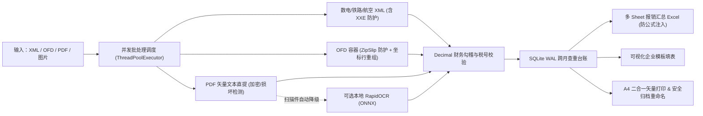

# 票溯（PiaoSu）v0.2.0

**纯离线中文数电票与传统票据报销引擎** — 面向个人报销与小微财务，支持数电票 XML、铁路电子客票、航空行程单、国标 OFD、矢量 PDF 双通道解析、`Decimal` 财务勾稽校验、SQLite WAL 跨月查重台账、可视化企业 Excel 模板自动填表、安全非破坏性归档重命名与 A4 二合一矢量合并打印。

> 100% 本地离线运行，零数据上传，保护企业与个人财务隐私。按 **MIT License** 开源。

---

## 与现有开源方案的核心差异

| 能力维度 | 传统纯 OCR 脚本 | 邮箱抓取类工具 | **票溯（PiaoSu）v0.2.0** |
| --- | --- | --- | --- |
| 数电票 XML / 国标 OFD / 铁路客票 | 仅靠 OCR，慢且易错字 | 部分支持 | **原生确定性解析 + OFD `Boundary` 坐标行重组 + 铁路 9% 价税拆算** |
| 隐私与离线安全 | 本地运行 | 需填邮箱授权码 | **纯离线本地运行；内置 XXE、Zip Slip、PDF 炸弹与 Excel 公式注入防护** |
| 财务金额校验 | 多用 `float` 易有精度误差 | 基础汇总 | **`Decimal` 精确勾稽校验（不含税+税额=价税合计），支持红字负数与免税 `***`** |
| 重复报销拦截 | 仅限单次文件夹内 | 单次为主 | **SQLite WAL 跨月持久化历史查重台账 + 批次撤销回滚 + JSON 备份** |
| 人工纠错闭环 | 导出后手工改 Excel | 无 | **桌面端双击行弹窗人工修正 → 即时重跑校验与全批查重** |
| 企业自有报销模板 | 固定表头 | 固定表头 | **可视化列映射器（自动探测工作表与表头列、保存预设）+ 开箱示例模板** |
| 打印与文件归档 | 无或栅格化失真 | 无 | **A4 二合一矢量合并打印 + 只复制不删改原件的规范重命名与 SHA256 对照表** |

---

## 系统架构



---

## 安全与工程设计亮点

1. **解析层纵深防御**：XML 解析禁用 `DOCTYPE`/`ENTITY` 并限制 10 MiB 体积防止 XXE 与 Billion Laughs；OFD ZIP 读取校验压缩包条目上限、解压总大小与路径穿越（Zip Slip）；PDF 解析拦截加密/损坏文件及体积上限。
2. **坐标感知排版还原**：国标 OFD 无内嵌 XML 时按 `<ofd:TextObject>` 的 `Boundary` (x, y) 坐标聚簇视觉行并从左到右拼接；PDF 采用 `sort=True` 适配左右双栏排版。
3. **财务级精度与原子持久化**：全程使用 `decimal.Decimal` 杜绝浮点误差；SQLite 启用 `WAL` 与外键约束，Excel/JSON 写出先落临时文件再 `os.replace` 原子替换；Excel 单元格转义 `= + - @` 前缀防 DDE/公式注入。
4. **可交互闭环**：桌面端支持双击行修正并重算全批查重、可视化模板列映射保存预设、历史台账回滚及只复制不改删原件的安全归档。

---

## 快速开始

### 安装依赖与启动

```bash
pip install -e .
# 如需识别纯图片/扫描件发票，安装可选本地离线 OCR：
pip install -e ".[ocr]"

# 启动中文桌面图形界面
python -m piaosu gui
```

### 命令行用法

```bash
# 环境与解析通道自检
python -m piaosu doctor

# 批量解析、查重、导出 Excel、生成 A4 合并打印 PDF、安全归档重命名并入账
python -m piaosu scan ./invoices ^
  --excel 报销汇总.xlsx ^
  --merge-pdf 打印合集.pdf ^
  --archive-dir ./归档发票 ^
  --commit --note "2026-11差旅报销"

# 按企业自定义 Excel 模板自动填表（内置 examples/ 示例模板与映射）
python -m piaosu scan ./invoices ^
  --template examples/示例企业报销单模板.xlsx ^
  --mapping examples/示例模板映射.json ^
  --template-out 已填报销单.xlsx

# 管理历史台账（查看批次 / JSON 备份 / 撤销回滚）
python -m piaosu ledger list
python -m piaosu ledger export-json backup.json
python -m piaosu ledger rollback B20261122-105000
```

---

## Windows 免安装绿色版构建与发布

仓库内置原生 Win32 C 启动器（[windows/launcher.c](windows/launcher.c)，含 `VS_VERSION_INFO` 与 `asInvoker` 清单，零外部 CRT 依赖）与 GitHub Actions 自动发布流水线（[.github/workflows/release.yml](.github/workflows/release.yml)）。

本地已编译 `prebuilt_windows/piaosu.exe` 后，可传入官方 Python 3.12 嵌入运行目录构建绿色包：

```powershell
python -m tools.build_windows_release --runtime-dir <python-embed-runtime-dir>
```

---

## 性能基准与测试（本机实测）

- **自动化测试**：`python -m unittest discover -s tests -v` — **21 项单元与集成测试全部通过**（含 XXE/ZipSlip/公式注入安全测试、铁路/航空/红字/免税/双栏 PDF/分离坐标 OFD 解析、台账跨月查重与回滚、CLI 全流程及 Tkinter GUI 弹窗冒烟测试）。
- **100 张混合票据并发实测**（30 张数电 XML + 10 张铁路电子客票 XML + 20 张内嵌 XML 的 OFD + 20 张坐标分离 OFD + 20 张双栏矢量 PDF，4 线程含 SHA256 与 SQLite 查重）：总耗时 **`199.5 ms`**，**100/100 全部一次通过校验**。

## License

[MIT License](LICENSE)
